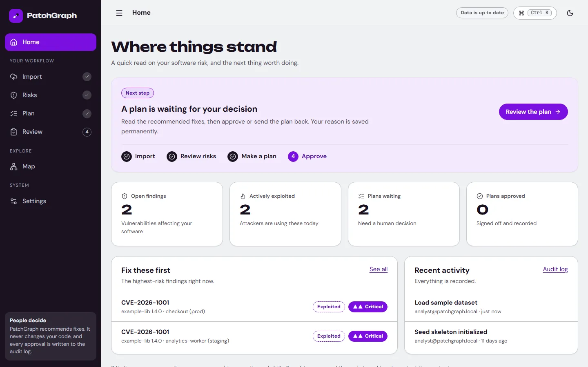
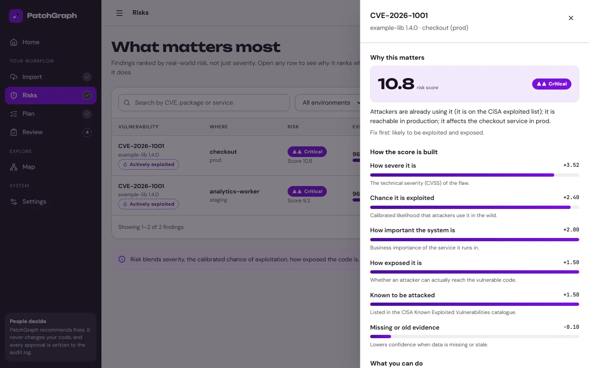
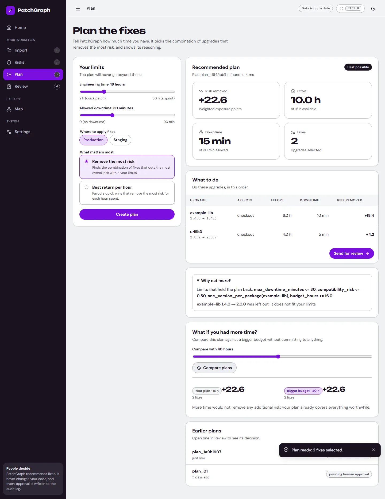
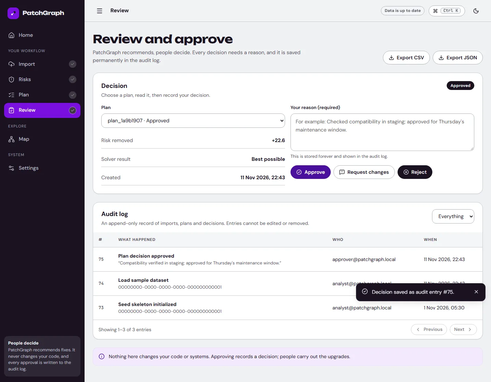

# PatchGraph — Explainable, Constrained Supply-Chain Remediation

[](https://github.com/FarhanAaqil/PatchGraph/actions/workflows/ci.yml)
[](contracts/openapi.yaml)
[](frontend/)
[](backend/)
[](pyproject.toml)
[](intelligence/planner/)

> **"Patch what matters."**
> PatchGraph explains and recommends; it never patches code automatically. Humans approve. Always. Every remediation decision requires explicit human sign-off with mandatory justification, permanently sealed into an append-only audit log.

---

## Architecture Overview

```
                                      +------------------------------------+
                                      | Upstream Feeds & Ingest Artifacts   |
                                      | - CycloneDX 1.5 & SPDX 2.3 SBOMs   |
                                      | - OpenVEX Machine Justifications   |
                                      | - OSV.dev, NVD CVE 2.0, EPSS, KEV  |
                                      +-----------------+------------------+
                                                        |
                                                        v
+-----------------------+              +----------------+-------------------+
| Web interface         | <--- API --- | FastAPI Gateway & Intelligence     |
| - React 18 + Vite     |  (Port 5000) | - SQLite (single file)             |
| - Guided 4-step flow  |              | - Platt Calibrated Risk Engine     |
| - Cytoscape.js map    |              | - Google OR-Tools CP-SAT Solver    |
| - TanStack Query      |              | - Append-Only Audit Ledger         |
| - Command Palette (⌘K)|              +------------------------------------+
+-----------------------+
```

---

## Core Guarantees & Principles

1. **Human Authority**: PatchGraph never pushes code or executes modifications autonomously. Every upgrade action requires explicit operator sign-off with mandatory justification comments permanently recorded in append-only cryptographic audit logs.
2. **Empirical Risk Scoring**: Replaces arbitrary severity scores with Platt-calibrated exploit probabilities, real EPSS percentiles, CISA KEV weaponization evidence, runtime reachability, and asset business criticality.
3. **Constrained Optimization**: Uses Google OR-Tools CP-SAT integer programming to solve optimal upgrade combinations within finite engineering hours, downtime windows, and breaking-change budgets.
4. **Contract-First Architecture**: `contracts/openapi.yaml` is the single source of truth, synchronizing backend routers and generating typed TypeScript clients for the frontend.
5. **No Invented Data**: Metrics come from the stored evidence snapshot and database, and seeded demo records are labelled as such. The offline demo uses placeholder content hashes for its pinned snapshot.

---

## 5-Step Pipeline

```
 [01 Ingest]   ──>   [02 Graph]   ──>   [03 Score]   ──>   [04 Optimize]   ──>   [05 Approve]
  CycloneDX           Reverse BFS        Platt Scaled       Google OR-Tools       Human Sign-Off
  & OpenVEX           Reachability       Exploit Prob       CP-SAT Solver         & Audit Ledger
```

- **01 Import (`/import`)**: Drag-and-drop CycloneDX 1.5/SPDX SBOMs, OpenVEX statements, and deployment topologies with SHA-256 content hashes.
- **02 Map (`/map`)**: Interactive diagram (plus an accessible list view) of packages, services and environments, with reverse-traversal blast radius.
- **03 Risks (`/risks`)**: Ranked findings with search and filters, and a "why this matters" panel that explains the score in plain language, with the factor breakdown and formula one click deeper.
- **04 Plan (`/plan`)**: Set effort budgets (0–60h) and maintenance downtime windows (0–90m) to generate mathematically optimal upgrade sets.
- **05 Review (`/review`)**: Human review gate with mandatory rationale requirement and an append-only verifiable audit timeline with CSV/JSON export.

---

## The interface



The web interface was rebuilt from scratch around one question: *what should I do next?*

- **A guided journey.** Import → Risks → Plan → Review. Home reads your real data and points at the next step.
- **Plain language first, detail on demand.** Every risk explains itself in a sentence, then shows the factor bars, and only then the formula (under "Advanced").
- **Honest states.** Skeletons that match the layout while loading, empty states with a clear next action, errors with a retry button.
- **Accessible by default.** Skip link, landmarks, keyboard-only use, focus trapping in panels, `aria` labels on every control, reduced-motion support, and a light and a dark theme. An automated test fails the build if a control loses its label.
- **Palette.** Only the five brand colours: Silver Metallic `#E6E9EE`, Deep Violet `#7A0FE0`, Electric Indigo `#4B0F9E`, Steel Gray `#8A929C`, Ink Void `#1A1220`. Every other shade is mixed from them. Severity and status always pair colour with a label or icon.
- **Type.** Unbounded for headlines, DM Sans for text, JetBrains Mono for IDs and hashes. All self-hosted.

| Risks and the "why" panel | Plan | Review |
|---|---|---|
|  |  |  |

---

## Performance

Measured with Lighthouse 12 against the production build served by the app itself (desktop and mobile with simulated slow 4G):

| Page | Perf (desktop / mobile) | Accessibility | Best practices | SEO | CLS |
|---|---|---|---|---|---|
| Home | 100 / 96 | 100 | 100 | 100 | 0.00 / 0.04 |
| Risks | 100 / 96 | 100 | 100 | 100 | 0.02 / 0.00 |
| Plan | 100 / 96 | 100 | 100 | 100 | 0.00 / 0.00 |
| Review | 100 / 95 | 100 | 100 | 100 | 0.01 / 0.00 |

The first screen ships about 80 kB of JavaScript (gzipped), down from roughly 270 kB before the rebuild. The 3D library is gone and the diagram library loads only when the Map opens.

| Technique | Status |
|---|---|
| Cache API responses | Done: ETag + `Cache-Control: no-cache` revalidation (empty `304`s), React Query `staleTime` |
| Server-side caching, expensive queries and computations | Done: per-app response cache that every write invalidates instantly; the exploit model is loaded once |
| Load balancer | Prepared: `docker/nginx.conf` (round-robin upstream, edge cache). Not active, because SQLite allows one app instance per database |
| CDN | Ready: hashed assets are served `public, max-age=31536000, immutable`, and nginx config caches them at the edge. No CDN account is configured |
| Index database tables | Done: 12 secondary indexes (`backend/migrations/002_indexes.sql`), verified with `EXPLAIN QUERY PLAN` |
| Optimise queries, fix N+1 | Done: SQL-level filtering/sorting/paging; finding detail is one query; plan list uses two batched queries instead of two per plan |
| Connection pooling | Not applicable: SQLite has a single writer, so one long-lived connection (WAL, tuned cache) is the pool |
| Paginate large lists | Done: findings, imports, assets, plans, audit log |
| Compress images | Done: documentation screenshots are WebP (3.2 MB of PNG became about 0.5 MB); the app itself ships no raster images |
| Compress API payloads | Done: gzip above 500 bytes, and the findings list no longer repeats source metadata per row |
| Optimise fonts | Done: self-hosted Latin subsets, `font-display: swap`, metric-matched fallbacks, the two critical fonts preloaded |
| Loading skeletons | Done on every table and card |
| Debounce input handlers | Done: search waits 300 ms |
| Eliminate unnecessary re-renders | Done: memoised rows, stable callbacks, no polling |
| Split code, reduce bundle, lazy loading | Done: one chunk per screen, vendor chunks, diagram library and command palette loaded on demand |
| Minify JS and CSS, defer scripts | Done: Vite production build, module scripts are deferred |
| Remove unused dependencies | Done: Three.js and Recharts removed |
| Eliminate unnecessary requests | Done: no polling, request de-duplication, no third-party requests (checked by a test) |
| Remove render-blocking resources | Done: no external stylesheets or fonts |
| Improve server response time | Done: `Server-Timing` header on every response, typical API reads under a few milliseconds |
| Core Web Vitals | Layout shift 0 to 0.04 on all screens; mobile LCP about 2.5 s under simulated slow 4G, desktop 0.6 s |
| Run Lighthouse audits | Done, results above |

---

## Quickstart

### Option 1: Run locally

```bash
# 1. Python environment (3.12)
python -m venv .venv
source .venv/bin/activate        # Windows: .venv\Scripts\activate
pip install -r requirements-dev.lock

# 2. Build the web interface
cd frontend && npm ci && npm run build && cd ..

# 3. Start the API and UI together on port 5000
python scripts/run_standalone_server.py --port 5000
```

Open **[http://127.0.0.1:5000](http://127.0.0.1:5000)**. The first start creates and seeds `data/patchgraph.db`
(override the location with `PATCHGRAPH_SQLITE_PATH`).

### Option 2: Docker

```bash
docker compose up --build
```

One container serves the API and the UI on `http://localhost:5000` (interactive API docs are off by default; set `PATCHGRAPH_ENABLE_DOCS=true` to serve `/docs`), with SQLite on a named
volume. `docker/compose.prod.yml` is the production-style variant: read-only filesystem, bearer tokens required, and
`PATCHGRAPH_AUTH_SIGNING_KEY` must be set.

---

## Authentication

| Mode | When | How callers identify themselves |
|---|---|---|
| Demo (default) | Local runs and tests | `X-Project-Id` / `X-User-Id` headers, defaulting to the seeded approver |
| Production | `PATCHGRAPH_ENV=production` | `Authorization: Bearer <token>` only; identity headers are ignored |

In both modes the caller's role comes from the `memberships` table. `X-User-Role` (or the role inside a token) can
only lower it, never raise it. Tokens are HMAC-signed with `PATCHGRAPH_AUTH_SIGNING_KEY`; production refuses to start
without one. Mint a token with:

```bash
PATCHGRAPH_AUTH_SIGNING_KEY=... python scripts/issue_token.py <user_id> <email> <project_id> <role>
```

The web client sends the token stored in `localStorage` under `patchgraph.token`.

---

## Development

Work happens on `master`; each phase of work is a pull request into `main` that must pass CI before merging
(`scripts/github_pr.py` opens the PR, waits for the checks and merges).

| Check | Command |
|---|---|
| Python lint + format | `ruff check .` and `ruff format --check .` |
| Backend tests (85) | `PYTHONPATH=. python -m unittest discover -s tests -p "test_*.py"` |
| Frontend format, lint, tests (21), build | `cd frontend && npm run format:check && npm run lint && npm test && npm run build` |
| End-to-end (16 Playwright tests) | start the server on port 5000, then `npm ci && npx playwright test` from the repo root |
| Docker image | `docker build .` |

Dependencies: `requirements.txt` lists runtime packages, `requirements-dev.txt` adds tooling, and the `.lock` files pin
exact versions (`uv pip compile requirements.txt --universal --python-version 3.12 -o requirements.lock`).
Tests write experiment output to a scratch directory (`PATCHGRAPH_OUTPUT_DIR`), so running them leaves the tree clean.

---

## API Endpoints Reference

| Method | Endpoint | Description |
|---|---|---|
| `GET` | `/health` | Service health |
| `GET` | `/api/v1/health/data` | Evidence snapshot freshness per source |
| `GET` | `/api/v1/sources/status` | Upstream source status from the stored snapshot (OSV, NVD, EPSS, KEV) |
| `POST` | `/api/v1/demo/load-sample` | Reset to the seeded sample scenario and re-score it |
| `POST` | `/api/v1/imports/sbom` | Ingest CycloneDX/SPDX SBOM (JSON body) |
| `POST` | `/api/v1/sbom/upload` | Ingest an SBOM file upload |
| `POST` | `/api/v1/imports/vex` | Ingest OpenVEX statements |
| `POST` | `/api/v1/imports/topology` | Register application deployment topology |
| `GET` | `/api/v1/imports`, `/api/v1/imports/{id}` | Import history and status |
| `GET` | `/api/v1/jobs/{id}`, `/api/v1/jobs/{id}/events` | Job status (404 for unknown jobs) |
| `GET` | `/api/v1/vex-statements` | Stored VEX statements |
| `GET` | `/api/v1/assets` | Asset inventory |
| `GET` | `/api/v1/graph`, `/api/v1/graph/paths`, `/api/v1/graph/nodes/{id}` | Dependency-and-deployment graph, reverse paths, node blast radius |
| `GET` | `/api/v1/findings`, `/api/v1/findings/{id}` | Prioritized risk findings |
| `GET` | `/api/v1/findings/{id}/explain` | Decomposed risk factor breakdown & Platt formula |
| `POST` | `/api/v1/risk-runs` | Score all findings with the calibrated model |
| `GET` | `/api/v1/risk-runs/latest` | Latest risk run |
| `GET` | `/api/v1/model-card` | Model card and evaluation metrics |
| `POST` | `/api/v1/plans` | Run the OR-Tools CP-SAT remediation optimizer |
| `GET` | `/api/v1/plans`, `/api/v1/plans/{id}` | Planning runs |
| `POST` | `/api/v1/plans/{id}/simulate` | What-if simulation |
| `POST` | `/api/v1/plans/{id}/decision` | Human approval sign-off (writes to the audit log) |
| `GET` | `/api/v1/audit`, `/api/v1/audit/export` | Append-only audit log, JSON or CSV export |

`contracts/openapi.yaml` is the API contract. The running server does not publish `/docs`, `/redoc` or `/openapi.json` unless `PATCHGRAPH_ENABLE_DOCS=true`, and the web interface never shows endpoint URLs or lets users change an API address.

## Known limitations

- Storage is SQLite only. The schema is written as PostgreSQL DDL and translated, but there is no Postgres driver.
- Topology import acknowledges the request but does not yet parse the uploaded topology file.
- `contracts/openapi.yaml` documents a subset of the routes above; the generated docs (when enabled) are complete.

---

## Author

- **Farhan Aaqil** ([@FarhanAaqil](https://github.com/FarhanAaqil))
