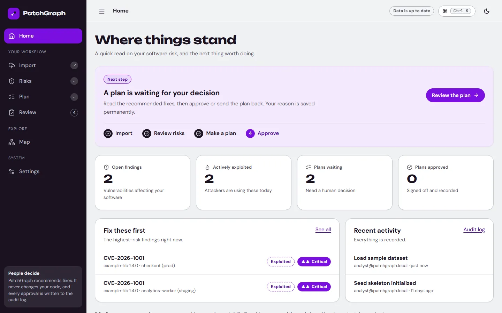
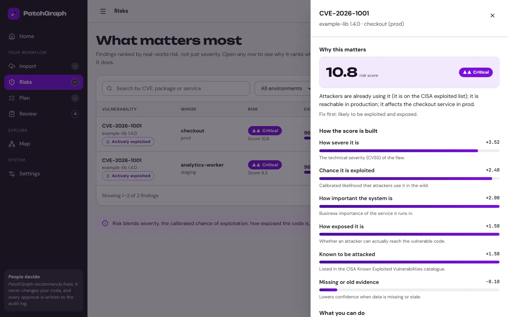

# PatchGraph: quick user guide

PatchGraph helps you decide which software vulnerabilities to fix first, and plans the fixes that fit the time you have. The left menu follows one journey: **Import → Risks → Plan → Review**. The **Home** screen always shows the next step.

## 1. Import your software

Open **Import**. Drop a software bill of materials (CycloneDX 1.4–1.6 or SPDX 2.3, JSON, up to 25 MB), or paste the JSON. You can also add an OpenVEX file with vendor statements about flaws that do not affect you. Every file is fingerprinted with a SHA-256 hash, and importing the same file again changes nothing. New here? Press **Load sample data**.

## 2. See what matters most

Open **Risks**. Findings are ranked by real-world risk, and you can search, filter by environment and show only flaws that are being actively exploited. Open a row to see why it ranks where it does: a plain sentence first, then six factors with bars, then the formula under **Advanced**.

The score combines severity, the calibrated chance of exploitation, how exposed the code is, how important the service is and whether the flaw is on the CISA known-exploited list. Missing evidence lowers confidence; it is never treated as safe.

## 3. Plan the fixes

Open **Plan**. Set your engineering hours, allowed downtime and environments, choose what matters most, and press **Create plan**. You get the upgrades to do, the effort and downtime they need, and why other options were left out. **Compare plans** re-solves with a bigger budget so you can see whether more time would help.

## 4. Review and approve

Open **Review**. Choose a plan, write your reason (required), and approve, request changes or reject. The decision is added to the audit log, which can be filtered and exported as CSV or JSON. Approving needs the approver or admin role; PatchGraph itself never changes your code or systems.

## Also useful

* **Map** shows how packages, services and environments connect, with a list view for screen readers.
* **Settings** shows the data sources, switches between the light and dark themes and lists the keyboard shortcuts. Press `Ctrl`/`⌘` + `K` anywhere to jump to a screen.
